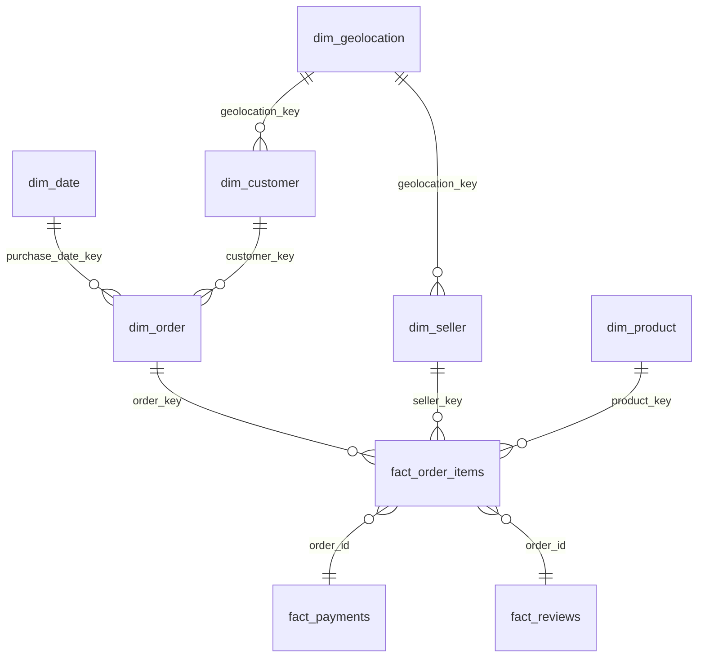
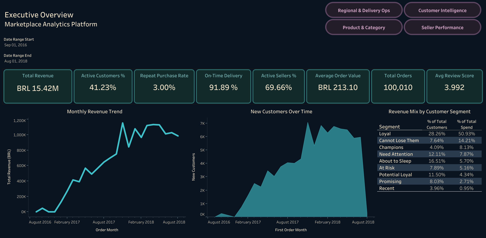
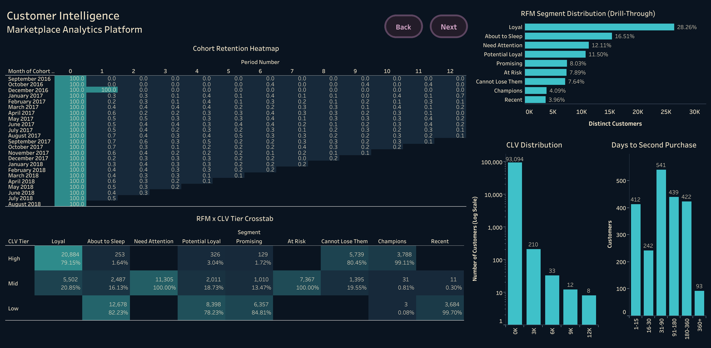
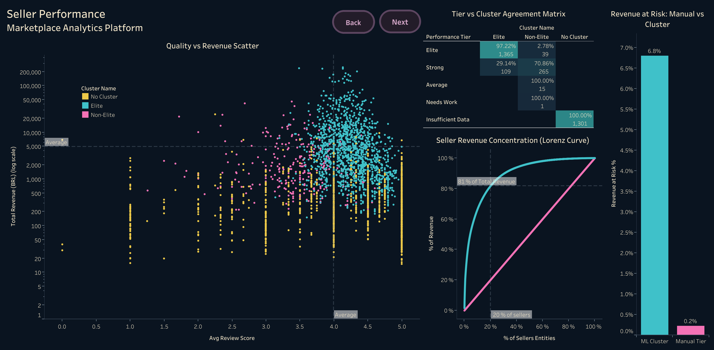
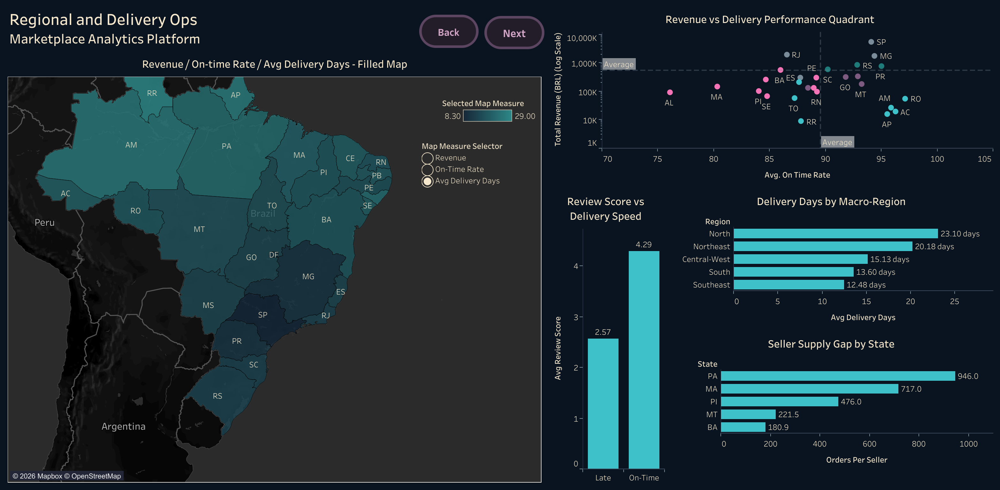
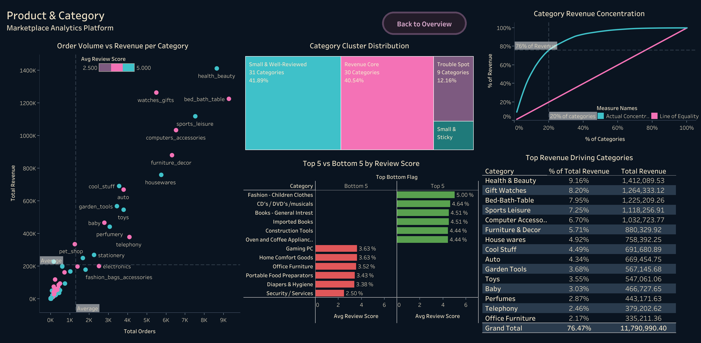
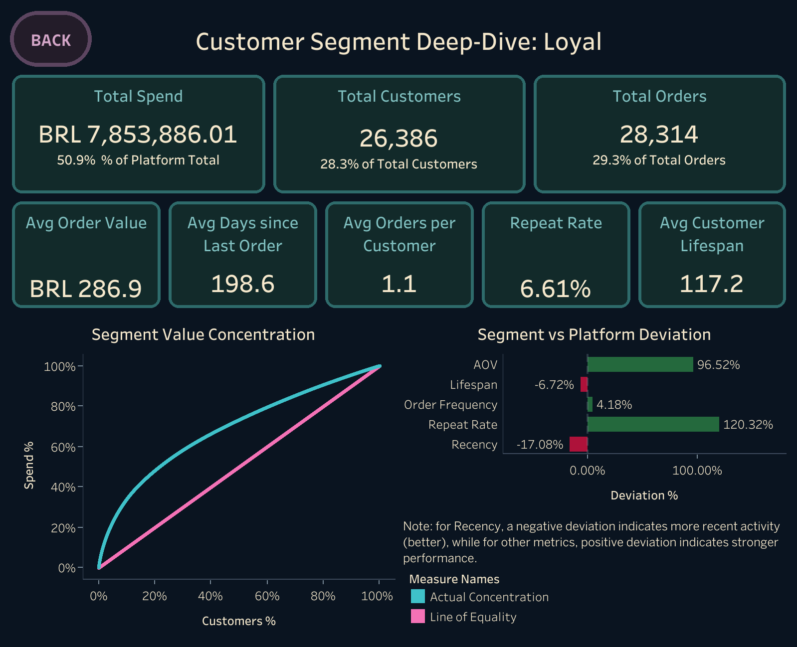
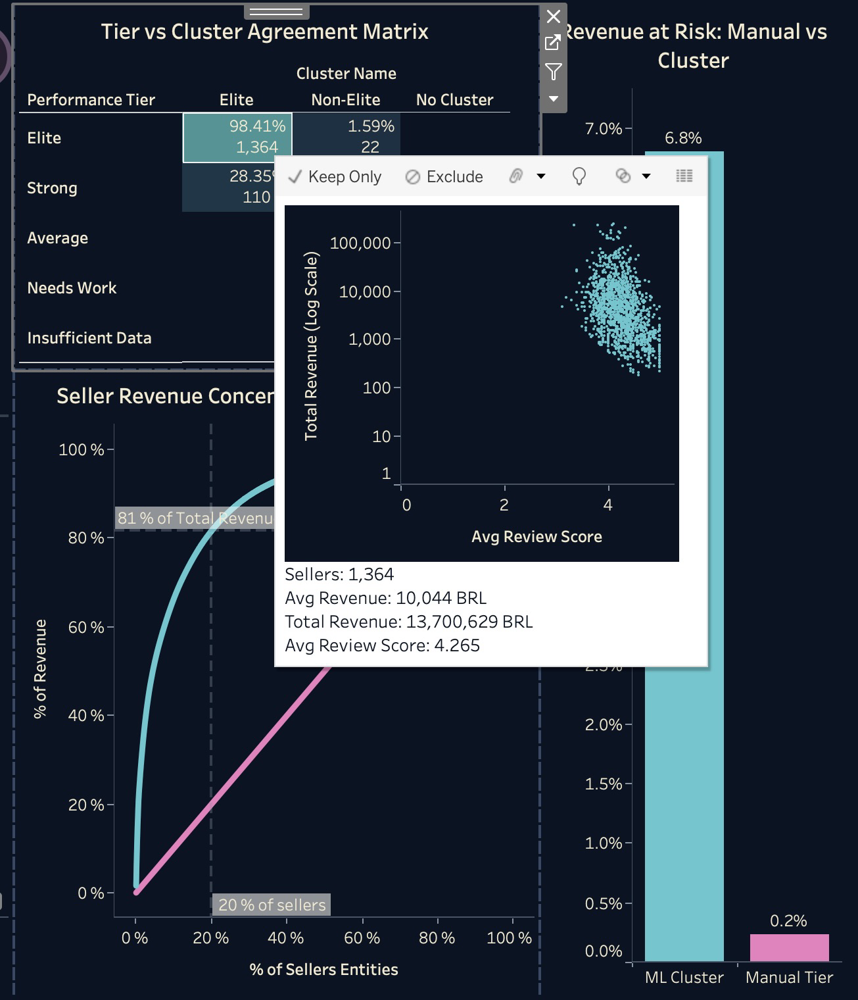

# Marketplace Analytics Platform

### Customer, Seller & Regional Intelligence for a Brazilian E-Commerce Marketplace

**[Live Dashboard — Tableau Public](https://public.tableau.com/views/MarketplaceAnalyticsPlatform/ExecutiveOverview?:language=en-US&:sid=&:redirect=auth&:display_count=n&:origin=viz_share_link)**

---

## Project Overview

The Marketplace Analytics Platform is an end-to-end data and analytics project built on real Brazilian e-commerce data from Olist, a marketplace connecting small and medium-sized sellers to customers across Brazil. It transforms roughly 100,000 raw transactional records spanning September 2016 – October 2018 into a structured PostgreSQL data warehouse, a layer of SQL analytical views, a suite of Python statistical and machine-learning notebooks, and a 6-dashboard Tableau workbook — culminating in a leadership-facing findings and recommendations memo.

The project is built as a complete, production-style data analyst / BI workflow: raw data profiling and quality assessment → warehouse schema design and ETL → SQL analytics → Python statistical analysis and clustering → Tableau dashboard delivery → synthesized business recommendations. Every number in every layer traces back to real, validated data — no synthetic inputs were used at any stage.

---

## Business Problem

Olist operates as a marketplace intermediary, meaning its health depends on two distinct groups simultaneously — the customers who buy, and the sellers who list and fulfill orders. Raw transactional data alone can't answer the questions that actually matter to the business:

- Who are the most valuable customers, and which ones are genuinely at risk of churning?
- Which sellers are driving a good customer experience, and which are quietly damaging it?
- Where is revenue concentrated geographically, and where are the real growth gaps?
- Are customers coming back, or is this platform primarily acquiring one-time buyers?
- Does delivery experience actually drive satisfaction, or is it product and price?
- How much of current revenue comes from customers the platform already had?

This project builds the full analytical foundation needed to answer these — from 9 raw CSVs to a validated warehouse, an analytical view layer, statistically-tested findings, and a dashboard suite non-technical stakeholders can use directly.

---

## Project Objectives

| # | Objective | Why It Matters |
|---|---|---|
| O1 | Profile and validate all 9 raw data sources | Ensures the analytical foundation is built on trustworthy, well-understood data |
| O2 | Design and implement a PostgreSQL star schema | A structured, query-optimized single source of truth for all downstream analysis |
| O3 | Build a reproducible Python ETL pipeline | Documented, idempotent, re-runnable warehouse loading with explicit cleaning rules |
| O4 | Develop SQL analytical views | Business-ready metrics across customer, seller, product, payment, and regional dimensions |
| O5 | Deliver Python analysis notebooks | Regression, hypothesis testing, and clustering that go beyond what SQL alone can express |
| O6 | Deliver a Tableau dashboard suite | Makes insights accessible without requiring SQL or Python knowledge |
| O7 | Synthesize a leadership-facing findings memo | Converts three analysis layers into curated, decision-ready recommendations |

---

## Dataset

| | |
|---|---|
| **Source** | [Olist Brazilian E-Commerce Public Dataset](https://www.kaggle.com/datasets/olistbr/brazilian-ecommerce) (Kaggle) |
| **License** | Creative Commons Attribution Non-Commercial-ShareAlike 4.0 International (CC BY-NC-SA 4.0) |
| **Coverage** | September 2016 – October 2018, 27 Brazilian states |
| **Volume** | ~100,000 orders across 9 relational CSVs |
| **PII** | None — all customer and seller identifiers are cryptographically anonymized at source |

---

## Data Provenance

This project uses real, anonymized data published by Olist on Kaggle under a Creative Commons Attribution Non-Commercial-ShareAlike 4.0 International license. No synthetic data has been used or introduced at any stage of this project — every figure in every document, notebook, and dashboard traces back to this real dataset. Full table-by-table detail is in [`docs/02_data_dictionary.md`](docs/02_data_dictionary.md) and quality findings are in [`docs/03_data_assessment_and_quality_report.md`](docs/03_data_assessment_and_quality_report.md).

---

## Data Warehouse & Data Model

The warehouse is a PostgreSQL star schema with a multi-fact design: `fact_order_items` (line-item grain) plus two order-grain fact tables, `fact_payments` and `fact_reviews`, kept separate to avoid fan-out. All three connect through `order_id` as a degenerate dimension. Full rationale for every design decision is in [`docs/04_schema_design.md`](docs/04_schema_design.md).



On top of the warehouse sit two analytical layers:

- **13 SQL views** (`sql/views/`, documented in [`docs/06_views_reference.md`](docs/06_views_reference.md)) — RFM, CLV, cohort retention, seller scorecards, regional analysis, Pareto concentration, delivery experience, category affinity, payment behavior, and more.
- **4 materialized ML output tables** (`ml_seller_clusters`, `ml_seller_outliers`, `ml_category_clusters`, `ml_review_score_feature_importance`) — the handful of findings that require a trained K-means or Random Forest model, which neither SQL nor Tableau can produce natively. Full rationale in [`docs/08_ml_outputs_reference.md`](docs/08_ml_outputs_reference.md).

---

## Dashboard Preview

**Executive Overview**



**Customer Intelligence**



**Seller Performance**



**Regional & Delivery Ops**



**Product & Category**



**Segment Deep-Dive (Drill-Through)**



**Custom Tooltip — Live-Filtered Mini Scatter**



---

## Interactive Features

- **Segment Deep-Dive drill-through** — clicking any bar on the RFM Segment Distribution chart fires three simultaneous dashboard actions (filter, navigate, change parameter) to open a dedicated per-segment analysis page with a dynamic, parameter-driven title.
- **Viz-in-tooltip** — hovering the Elite cell of the Seller Performance Tier vs. Cluster Agreement Matrix embeds a live, filtered mini scatter plot showing that specific cell's sellers.
- **Parameter-driven choropleth** — the Regional & Delivery Ops map switches between Revenue, On-Time Rate, and Avg Delivery Days via a single parameter control, re-coloring the same map rather than requiring three separate maps.
- **Page navigation** — Back/Next buttons chain all five main dashboards into a guided flow.
- **Scoped date filter** — a Date Range parameter filters the Executive Overview's time-series charts specifically; it's deliberately not applied platform-wide, since the other dashboards are current-state snapshots rather than time series.

---

## Key Features

**Data Modeling**
- Multi-fact star schema with surrogate keys
- Programmatically generated date dimension
- Deduplicated geolocation dimension (1M raw rows → one row per zip prefix)

**ETL Pipeline**
- Two-layer staging → warehouse architecture, fully idempotent and re-runnable
- 12 documented data-quality findings, each with an explicit cleaning rule
- `COPY`-based bulk load to handle the 1M-row geolocation table

**SQL Analytics**
- 13 business-ready views spanning customer, seller, product, payment, and regional dimensions
- RFM segmentation, CLV projection, cohort retention, Pareto concentration analysis

**Python Statistical Analysis & ML**
- Regression and hypothesis testing (delivery time vs. review score, payment method vs. order value, first-purchase category vs. repeat rate)
- K-means clustering on sellers and product categories
- Random Forest feature-importance analysis on review score drivers

**Tableau Development**
- 6-dashboard workbook (5 main dashboards + 1 drill-through) across 41 worksheets and 9 federated data sources
- Drill-through, viz-in-tooltip, and parameter-driven interactivity

---

## Analytical Workflow

```
Executive Overview
   → Customer Intelligence (+ Segment Deep-Dive Drill-Through)
      → Seller Performance
         → Regional & Delivery Ops
            → Product & Category
```

This mirrors the workbook's actual navigation — from platform-wide health indicators down to per-segment, per-seller, and per-region root-cause detail, while keeping each dashboard usable on its own.

---

## Key Findings

The full curated analysis is in [`docs/13_key_insights_recommendations.md`](docs/13_key_insights_recommendations.md). Headlines:

- **Retention is structural, not situational.** Only 3.00% of the platform's 93,358 customers ever place a second order, and the drop-off is uniform across every cohort in the dataset — not a fixable onboarding gap.
- **Delivery speed is the single highest-confidence lever in the entire project.** It's the strongest, most consistent relationship found across the SQL, Python, and Tableau layers — accounting for 81% of feature importance in a Random Forest model built specifically to find competing explanations.
- **The business runs on a narrow core.** Roughly 89% of platform revenue flows through the Elite-clustered seller group alone; three of nine customer segments carry ~73% of revenue; 76% of category revenue comes from 20% of categories.
- **The manual grading systems currently in use are miscalibrated.** Statistically validated clustering shows seller revenue-at-risk is roughly 30x higher than the manual tiering system suggests, and two RFM segment labels (`At Risk`, `Need Attention`) overstate customer value.
- **Regional inequality is self-reinforcing.** Delivery time, seller supply, and revenue move together geographically — the states with the thinnest seller presence are also the slowest and lowest-revenue.

---

## Business Recommendations

Full recommendations, each paired with a quantified business exposure figure, are in [`docs/13_key_insights_recommendations.md`](docs/13_key_insights_recommendations.md). In brief:

- Treat repeat-purchase rate as a structural characteristic, not a metric minor tweaks will move.
- Prioritize delivery-time reduction over the alternative levers this project tested and ruled out (freight cost, review-response speed).
- Protect the narrow revenue core (Elite sellers, Loyal/Champions/Cannot-Lose-Them customers, Revenue Core categories) before funding long-tail acquisition.
- Cross-check RFM segment and seller tier labels against CLV tier and ML cluster assignment before allocating retention or intervention spend.
- Target seller-supply density first in the identified regional gap states (Pará, Maranhão, Piauí).

This project deliberately does not rank these by priority or estimate implementation effort — those are resourcing decisions for leadership, not calls a BI analysis should make on their behalf.

---

## Technology Stack

| Layer | Tools |
|---|---|
| Data Warehouse | PostgreSQL (local) |
| Data Processing & Analysis | Python 3.11 — pandas, numpy, SQLAlchemy, psycopg2, matplotlib, seaborn, scipy, statsmodels, scikit-learn |
| Development Environment | Conda (`Marketplace-Analytics-Platform`), JupyterLab |
| Visualization | Tableau Desktop / Tableau Public |
| Version Control | Git / GitHub |
| Documentation | Markdown |

---

## Repository Structure

```text
Marketplace-Analytics-Platform/
│
├── dashboards/
│   ├── 00_executive_overview.png
│   ├── 01_customer_intelligence.png
│   ├── 02_seller_performance.png
│   ├── 03_regional_delivery_ops.png
│   ├── 04_product_and_category.png
│   ├── 05_drill_through_segment.png
│   └── 06_custom_tooltip_viz.png
│
├── data/
│   ├── 01_download_instructions.md
│   └── 02_download_data.py
│
├── docs/
│   ├── 01_business_requirements.md
│   ├── 02_data_dictionary.md
│   ├── 03_data_assessment_and_quality_report.md
│   ├── 04_schema_design.md
│   ├── 05_etl_methodology.md
│   ├── 06_views_reference.md
│   ├── 07_findings_sql.md
│   ├── 08_findings_python.md
│   ├── 09_ml_outputs_reference.md
│   ├── 10_tableau_data_model.md
│   ├── 11_tableau_build_reference.md
│   ├── 12_findings_tableau.md
│   └── 13_key_insights_recommendations.md
│
├── notebooks/
│   ├── 01_data_assessment.ipynb
│   ├── 02_data_quality_check.ipynb
│   ├── 03_exploratory_data_analysis.ipynb
│   ├── 04_warehouse_validation.ipynb
│   ├── 05_customer_analysis.ipynb
│   ├── 06_seller_analysis.ipynb
│   ├── 07_operations_analysis.ipynb
│   └── 08_product_analysis.ipynb
│
├── python/
│   ├── etl/
│   │   ├── 01_load_staging.py
│   │   ├── 02_load_warehouse.py
│   │   ├── 03_materialize_ml_outputs.py
│   │   └── 04_export_for_tableau.py
│   └── utils/
│       ├── __init__.py
│       ├── date_conversion.py
│       ├── db_connection.py
│       ├── imports.py
│       └── load_data.py
│
├── sql/
│   ├── queries/
│   │   └── view_validation_queries.sql
│   ├── schema/
│   │   ├── 00_create_schemas.sql
│   │   ├── 01_create_staging_tables.sql
│   │   ├── 02_create_warehouse_tables.sql
│   │   └── 03_create_ml_output_tables.sql
│   └── views/
│       ├── clv.sql
│       ├── cohort_retention.sql
│       ├── customer_health.sql
│       ├── delivery_experience.sql
│       ├── new_vs_returning_revenue.sql
│       ├── pareto_analysis.sql
│       ├── payment_behaviour.sql
│       ├── product_customer_affinity.sql
│       ├── regional_analysis.sql
│       ├── review_response_intelligence.sql
│       ├── rfm.sql
│       ├── seller_health.sql
│       └── seller_performance.sql
│
├── .gitignore
├── environment.yml
└── README.md
```

---

## Getting Started

**1. Clone this repository and create the conda environment**

```bash
conda env create -f environment.yml
conda activate Marketplace-Analytics-Platform
```

**2. Download the raw data**

Follow [`data/01_download_instructions.md`](data/01_download_instructions.md) — in short:

```bash
kaggle auth login
python data/02_download_data.py
```

**3. Create a local PostgreSQL database**

```bash
createdb Marketplace-Analytics-Platform
```

Set connection environment variables if your setup differs from the localhost defaults (see [`python/utils/db_connection.py`](python/utils/db_connection.py)):

```bash
export OLIST_DB_HOST=localhost
export OLIST_DB_PORT=5432
export OLIST_DB_NAME=Marketplace-Analytics-Platform
export OLIST_DB_USER=postgres
export OLIST_DB_PASSWORD=your_password
```

**4. Build the schema and run the ETL pipeline, in order**

```bash
psql -d Marketplace-Analytics-Platform -f sql/schema/00_create_schema.sql
psql -d Marketplace-Analytics-Platform -f sql/schema/01_create_staging.sql
psql -d Marketplace-Analytics-Platform -f sql/schema/02_create_warehouse.sql
psql -d Marketplace-Analytics-Platform -f sql/schema/03_create_ml_outputs.sql

python python/etl/01_load_staging.py
python python/etl/02_load_warehouse.py
python python/etl/03_materialize_ml_outputs.py
python python/etl/export_for_tableau.py
```

**5. Explore**

- Open the notebooks in `notebooks/` in JupyterLab for the full statistical analysis, or
- Open the Tableau workbook directly, or view it live on [Tableau Public](https://public.tableau.com/views/MarketplaceAnalyticsPlatform/ExecutiveOverview?:language=en-US&:sid=&:redirect=auth&:display_count=n&:origin=viz_share_link).

---

## Documentation

All 13 documents live in [`/docs`](docs/):

| Doc | Covers |
|---|---|
| `01_business_requirements.md` | Business context, objectives, scope, deliverables |
| `02_data_dictionary.md` | Column-by-column reference for all 9 raw tables |
| `03_data_assessment_and_quality_report.md` | Data profiling and all 12 quality findings |
| `04_schema_design.md` | Star schema design, ERD, and design decisions |
| `05_etl_methodology.md` | Every cleaning and transformation decision, script by script |
| `06_views_reference.md` | All 15 SQL views — business question, logic, and known limitations |
| `07_findings_sql.md` | Descriptive SQL-layer findings |
| `08_ml_outputs_reference.md` | The 4 ML-derived materialized tables and their business rationale |
| `09_findings_python.md` | Regression, hypothesis testing, and clustering findings |
| `10_tableau_data_model.md` | The 9 Tableau data sources and what each powers |
| `11_tableau_build_reference.md` | Worksheet-by-worksheet build reference and calculated field dictionary |
| `12_findings_tableau.md` | Dashboard-driven narrative findings |
| `13_key_insights_recommendations.md` | Final synthesis — curated insights and recommendations for leadership |

---

## Project Outcome

This project demonstrates a complete, production-style analytics workflow — from raw data quality assessment and warehouse design through SQL analytics, Python statistical analysis and machine learning, interactive dashboard delivery, and a synthesized, decision-ready findings memo. The end result gives stakeholders a structured way to understand customer retention, seller quality, regional delivery performance, and category health on a real two-sided marketplace, and a clear set of data-backed recommendations to act on.
